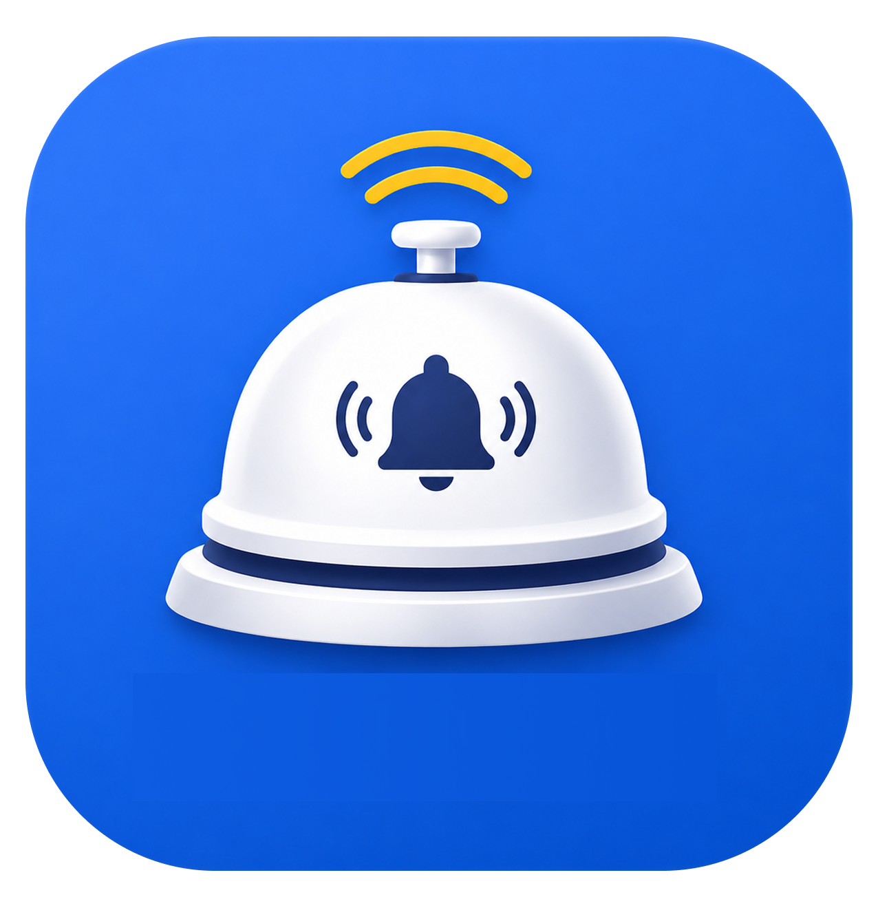
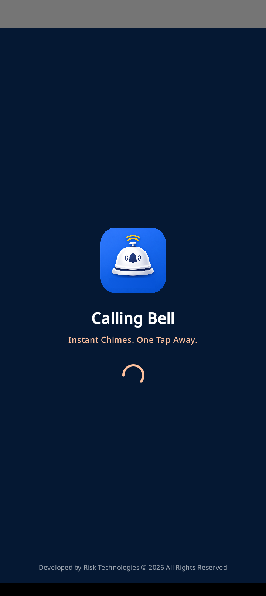
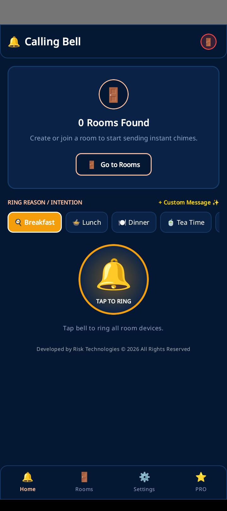
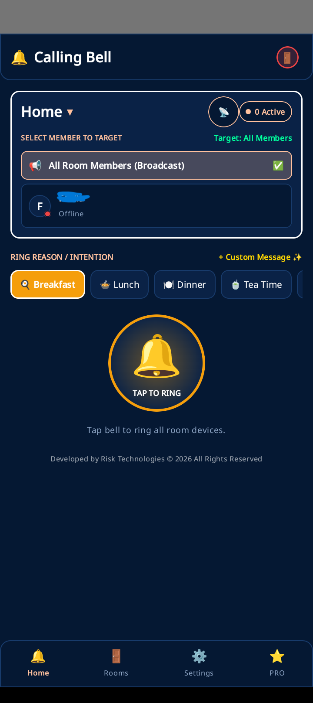
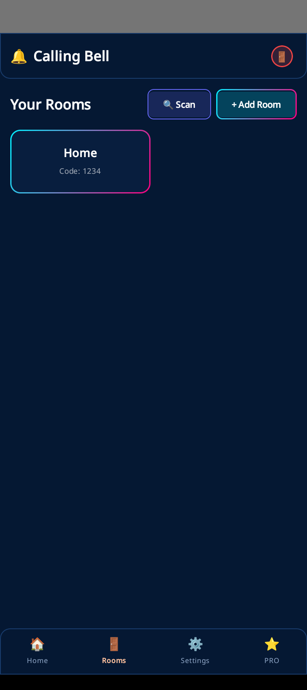
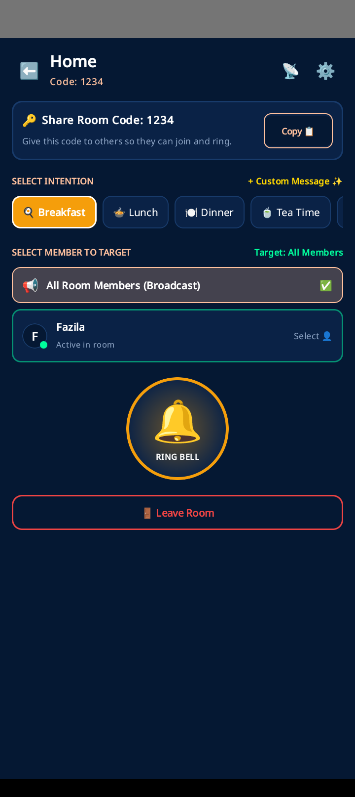
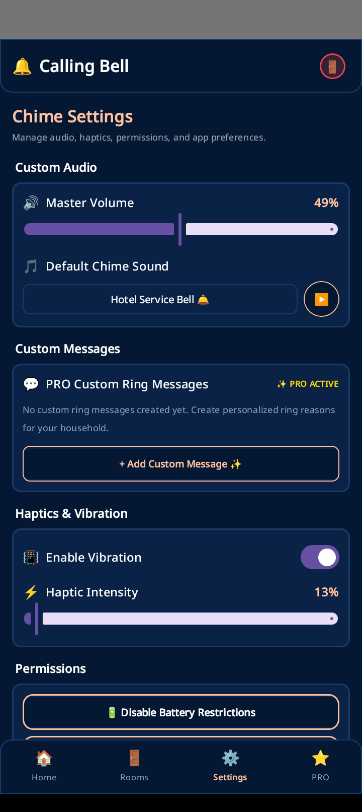
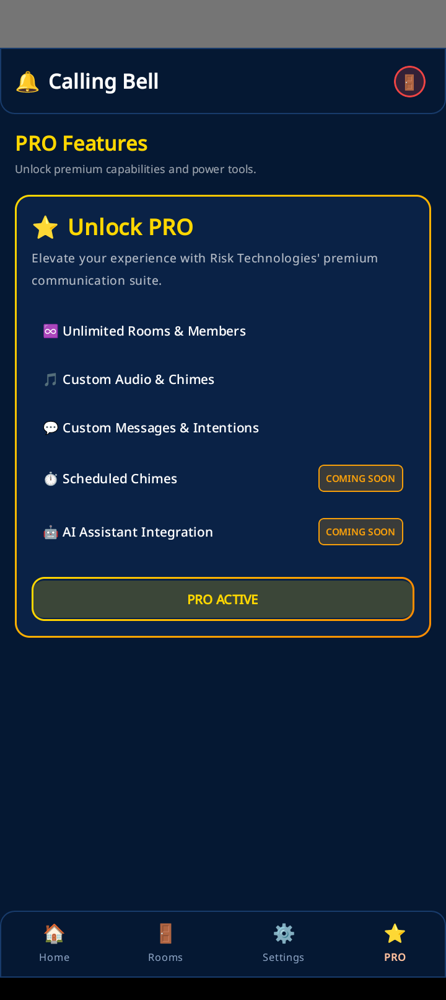

<p align="center">
  
</p>

<h1 align="center">Calling Bell</h1>

<p align="center">
  <b>Instant Household & Office Wi-Fi Chimes. One Tap Away.</b><br/>
  <i>A modern, native Android application built with Kotlin, Jetpack Compose, and UDP/FCM real-time synchronization.</i>
</p>

<p align="center">
  <a href="#-key-features">Key Features</a> •
  <a href="#-app-screenshots">App Screenshots</a> •
  <a href="#-project-architecture">Architecture</a> •
  <a href="#-getting-started">Getting Started</a> •
  <a href="#-tech-stack">Tech Stack</a>
</p>

---

## 📱 App Screenshots

<p align="center">
  
  
  
</p>

<p align="center">
  
  
  
  
</p>

---

## ✨ Key Features

- 🔔 **Targeted Ringing & Central Bell Button**: Tap a member to select/target them without accidental instant ringing. Ringing is executed only when tapping the main central bell.
- ✅ **Real-Time Delivery Confirmation Pop-Up**: Renders a floating **Delivery Acknowledgment Banner** alerting users with green `✅ Ring Delivered!` (showing recipient details) or red `❌ Ring Not Delivered` (explaining offline/network reasons).
- 💬 **PRO Custom Ring Messages & Manager**: PRO users can create custom ring reasons with custom text and emojis (e.g. *"Meeting in 5 mins ☕"*, *"Dinner Ready 🍕"*). Delete unwanted messages with 1-tap `🗑️` in Settings or `✖` inline on chips.
- 📜 **Home Page Roster Scrollability**: Bounded scrollable roster containers (`heightIn(max = 200.dp)`) enable smooth scrolling through > 3 members and rooms directly on the home page.
- 🔍 **Network Room & Member Scanning**: 1-tap **Scan Available Rooms** (`🔍`) to discover network rooms and **Scan Members** (`📡`) to trigger live UDP/FCM heartbeats.
- 🛡️ **Unique Room Code Enforcement**: Duplicate room code validation prevents creating rooms with existing codes, accompanied by a **✨ Generate Code** helper.
- 📳 **Custom Haptics & Audio Chimes**: Fine-tune volume levels, pick chime sound profiles, and adjust haptic vibration intensity (waveforms).
- 🔋 **Battery Optimization & Notification Shortcuts**: One-tap permission shortcuts to disable battery restrictions for background chimes.
- 🎨 **Midnight Celestial Aesthetics**: Deep obsidian bento cards, glassmorphic UI, glowing accent borders, and dynamic animations.

---

## 🏗️ Project Architecture

The application is built natively for Android:

```
Calling Bell/
├── android-app/                       # Native Android Application (Kotlin + Jetpack Compose)
│   ├── app/src/main/java/com/example/callingbell/
│   │   ├── MainActivity.kt            # Jetpack Compose UI Screens, App Navigator, Delivery Pop-ups
│   │   ├── RingListenerService.kt     # Foreground Service listening for UDP & FCM payloads
│   │   ├── HeartbeatEventBus.kt       # SharedFlow real-time member discovery bus
│   │   ├── RingEventBus.kt            # SharedFlow real-time ring notification bus
│   │   ├── Utils.kt                   # Audio Player & Haptics Vibrator Waveform Helpers
│   │   └── data/
│   │       └── SharedPrefsManager.kt  # JSON SharedPreferences Manager (Rooms, Custom Intentions, Settings)
├── backend/                           # Node.js + Socket.IO server (Optional fallback gateway)
└── images/                            # Logos & App Screenshots
    ├── logo.png
    └── screens/                       # App screenshot gallery
```

---

## 🚀 Getting Started

### Prerequisites

- **Android Studio** (Ladybug / Jellyfish or newer)
- **JDK 17+**
- **Android Device or Emulator** (API Level 26+)

### Building and Running the App

1. **Clone the Repository:**
   ```bash
   git clone https://github.com/muhzahjr07/Calling-Bell.git
   cd Calling-Bell/android-app
   ```

2. **Build Debug APK:**
   Using the Gradle wrapper:
   ```bash
   .\gradlew.bat assembleDebug
   ```

3. **Deploy to Device/Emulator:**
   Open the `android-app` directory in Android Studio and click **Run** (`Shift + F10`).

---

## 🛠️ Tech Stack

- **UI Framework:** Jetpack Compose (Material3)
- **Language:** Kotlin 1.9+
- **Navigation:** Navigation Compose
- **Service & Networking:** Android Foreground Service, UDP Socket Broadcast, Firebase Cloud Messaging (FCM)
- **State & Concurrency:** Kotlin Coroutines & SharedFlow Event Busses
- **Local Storage:** Android SharedPreferences (JSON Serialized)
- **Haptics & Audio:** `Vibrator` Waveforms & `MediaPlayer`

---

## 📄 License & Attribution

Developed by **Risk Technologies** © 2026. All Rights Reserved.
